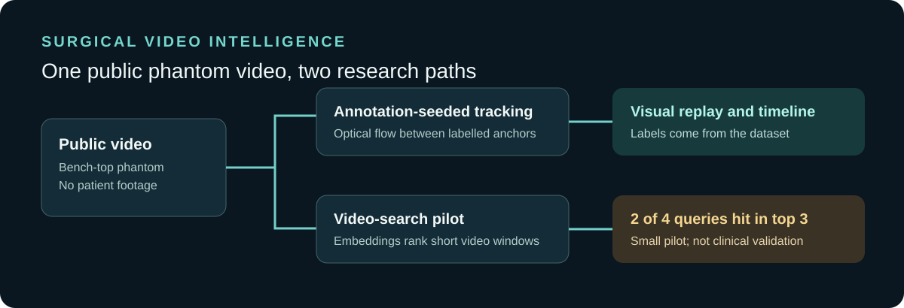
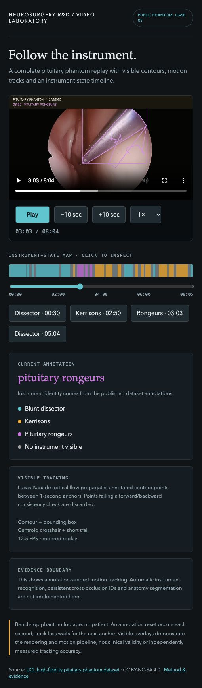
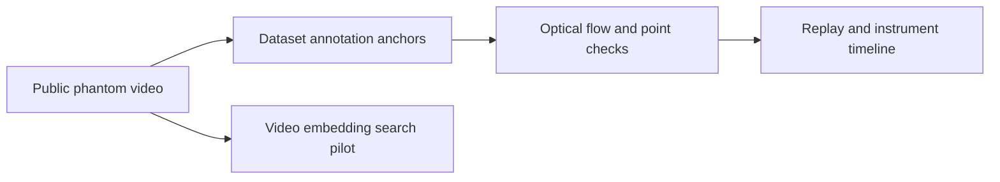

# Surgical video intelligence

Exploratory research for navigating surgical video using annotation-seeded instrument tracking and video search, tested on a public **bench-top phantom**.

[Research snapshot](research_snapshot/) · [Recorded evaluation](research_snapshot/retrieval-evaluation.json) · [Dataset](https://doi.org/10.5522/04/26511049.v1) · [Companion paper](https://doi.org/10.1049/htl2.12101)

**Status:** research snapshot and visual preview. The full video, model weights and source dataset are not included. No patient footage is published.

View the tracking interface

## What the research explores

- Published dataset annotations seed instrument contours and labels.
- Lucas–Kanade optical flow propagates contour points between one-second annotation anchors, with forward/backward consistency checks.
- An interactive timeline lets a viewer navigate instrument intervals in the recorded video.
- A separate video-only semantic-search pilot was evaluated on four fixed queries; relevant intervals appeared in the top three for two queries.

## Interpretation

Instrument identities shown in the tracking display come from dataset labels, not autonomous recognition. These results concern a small, exploratory test and do not establish clinical validity, patient outcomes or generalization. Tracking is re-anchored once per second. The search pilot missed two of its four fixed instrument queries.

## Data and attribution

The visual demo uses the public [Endoscopic Pituitary Surgery on a High-fidelity Bench-top Phantom dataset](https://doi.org/10.5522/04/26511049.v1) by Adrito Das, Danyal Khan, Nicola Newall, John Hanrahan, Danail Stoyanov, Hani Marcus and Sophia Bano, made available under [CC BY-NC-SA 4.0](https://creativecommons.org/licenses/by-nc-sa/4.0/). The screenshot is an adapted visualization of that dataset and is shared under the same license. See also the dataset's [companion paper](https://doi.org/10.1049/htl2.12101).

The [historical research snapshot](research_snapshot/) includes the tracking and retrieval scripts and recorded evaluation. It is a source snapshot, not a packaged standalone release; the full replay, dataset and model weights are not included.
