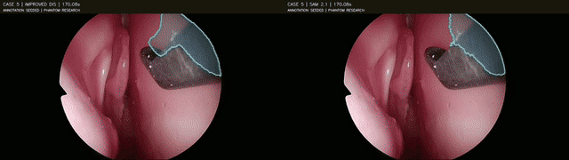

# Surgical video intelligence

An exploratory study of instrument-mask tracking on a public **neurosurgical training phantom**. This snapshot compares dense optical flow with SAM 2.1 over a complete eight-minute recording, using the same supplied annotation prompts and input frames.

*Public phantom footage, case 5. Left: DIS optical flow. Right: SAM 2.1 Hiera Tiny. Both masks are reseeded from dataset annotations once per second. The animation shows 170–178 seconds of the recording.*

## What was tested

The complete case 5 video contains 12,120 frames at a nominal 25 frames per second. The methods receive the supplied polygon at the start of each annotated second and propagate it to the next annotated frame. The two methods process identical JPEG frames. The score is computed **before** the next annotation is used to reset the mask.

| Method | Mean IoU | Median IoU | IoU ≥ 0.5 | Eligible transitions |
|---|---:|---:|---:|---:|
| DIS optical flow | 0.563 | 0.631 | 211 | 329 |
| SAM 2.1 Hiera Tiny | 0.784 | 0.864 | 295 | 329 |

Intersection over union (IoU) measures overlap between a predicted mask and the reference annotation; 1 is perfect overlap. Missing predictions count as zero. SAM 2 scored higher on 296 paired transitions and DIS on 33. These are **correlated checks from one phantom recording**, not independent surgical cases or evidence of clinical performance.

Transitions are eligible only when adjacent seconds both have unambiguous polygons for the same instrument class. Case 5 second 432 has multiple polygons and was excluded, as were adjacent comparisons depending on it. Absence, instrument re-entry and false overlays between annotations are not fully evaluated. Instrument identities and initial masks come from the dataset; neither method autonomously detects or classifies instruments in this experiment.

The [summary](results/case5-summary.json) and [per-transition scores](results/case5-anchor-scores.csv) are included. A second case is complete; its results are reported below.

## Research direction

This builds on earlier experiments in video search and visual representations. A saved historical V-JEPA 2.1 probe and a MedClaw-style evidence-navigation trial explored clip representations and targeted reinspection. They are separate experiments, not part of the tracking comparison above. The official MedClaw implementation has not been reproduced here. See the [existing research snapshot](https://github.com/ahmadalzaro1/surgical-video-intelligence/tree/main/research_snapshot) for the video-search pilot and its limitations.

The code folder is an **experiment snapshot**, not a standalone package: it expects OpenCV, NumPy, FFmpeg, PyTorch, the official SAM 2.1 source and Tiny checkpoint, and the public dataset at paths supplied by the operator. Dataset files, model weights and complete recordings are not included. Hardware: Apple GPU through MPS for the SAM 2 run; this snapshot is not a controlled runtime benchmark.

## Data and attribution

Das, Khan, Newall, Hanrahan, Stoyanov, Marcus and Bano, [Endoscopic Pituitary Surgery on a High-fidelity Bench-top Phantom](https://doi.org/10.5522/04/26511049.v1). The public dataset is licensed **CC BY-NC-SA 4.0**. The animation is adapted from that dataset and is shared under the same terms. The case 5 source file's published MD5 is `ad79ea604a3f93d40485ad9c9fb8bf6f`; the complete input matched it.

[SAM 2](https://github.com/facebookresearch/sam2) is by Meta; the authors state that its model code and checkpoints are Apache 2.0 licensed. Neither the model nor its weights are included in this snapshot.

This is an exploratory research result on simulated anatomy. It is not a clinical tool, patient-outcome analysis, or proof of state-of-the-art performance.

## Case 11: complete second recording

All 772 one-second intervals (19,300 frames at 25 fps) were processed. On 383 eligible paired one-second transitions, mean IoU was 0.683 for SAM 2 and 0.554 for DIS; SAM 2 scored higher on 304, DIS on 76, and three were tied. The methods were re-seeded from supplied annotations every second. These correlated observations from a second phantom recording are not independent procedures or clinical validation.

[Final summary](results/case11-summary.json) · [Per-transition scores](results/case11-anchor-scores.csv). The earlier partial files remain available for provenance.
